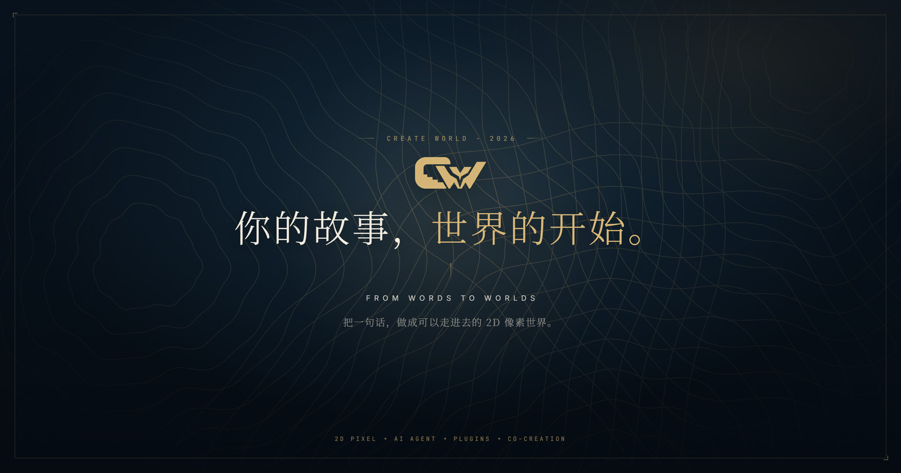
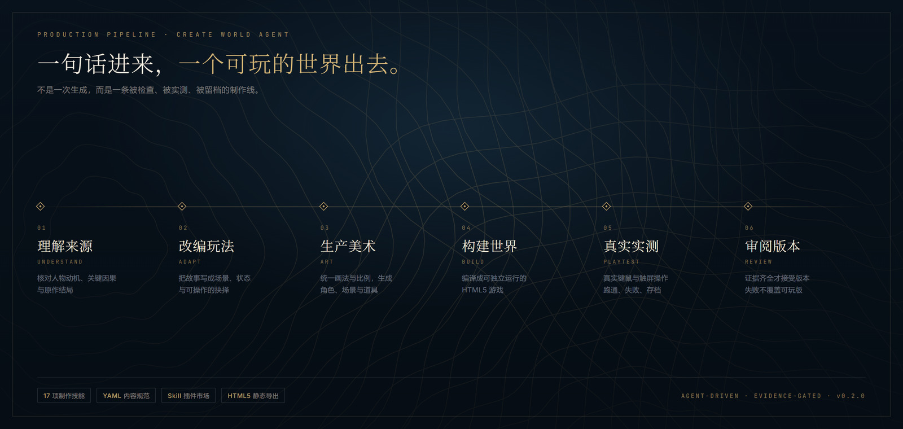
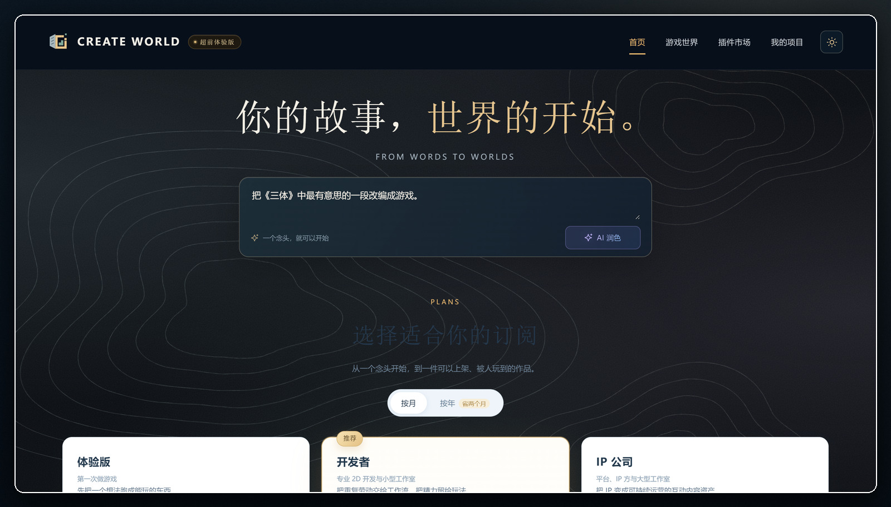
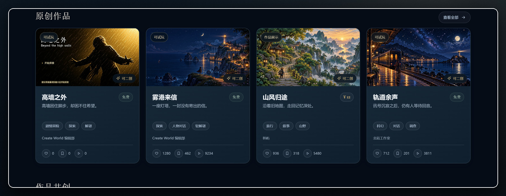
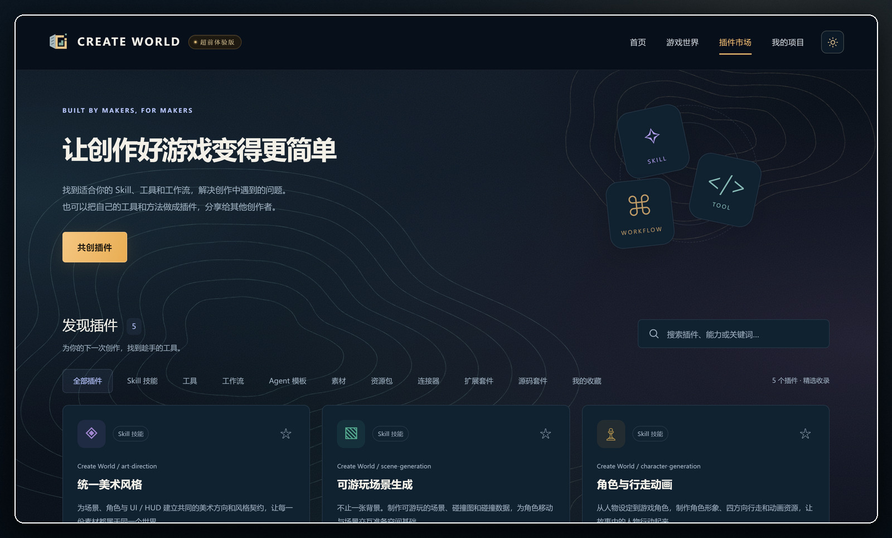
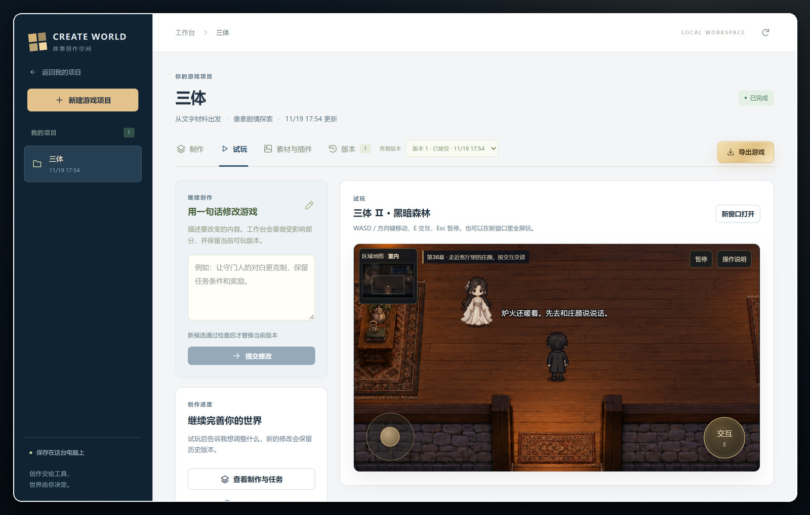
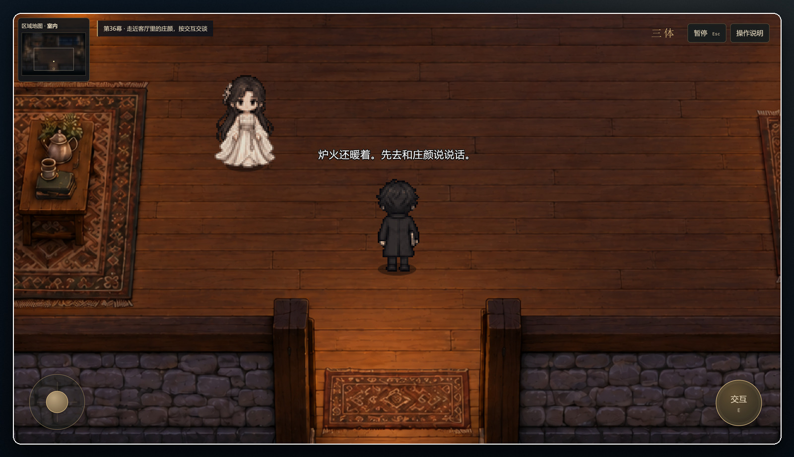

  

 

# 产品介绍

**Create World · AI 游戏创作平台与游戏共创社区**

当前聚焦 2D 像素剧情游戏

 

---

## OVERVIEW

Create World 面向 IP 粉丝、同人创作者、独立开发者与 IP / 品牌方。

用户描述一个 IP、一段故事或一个世界设定，平台将其制作为一款 2D 像素剧情游戏，包含场景、角色、对白、选择与结局。作品完成后可以继续修改、发布，也可以开放二次创作。

当前产品仅聚焦 2D 像素剧情游戏。

---

## FILM

2 分 30 秒产品短片，含中文字幕。

https://github.com/user-attachments/assets/04df0dd9-7341-461d-b7ec-2a46d0729d8b

短片中的作品可在 [在线体验](https://createworld.games) 直接试玩。

---

## MARKET

看故事的用户规模很大，具备游戏制作能力的用户很少。

| 指标 | 数据 | 来源 |
| --- | --- | --- |
| 中国微短剧用户规模 | **6.62 亿**（截至 2024.12） | 中国网络视听协会 |
| 成熟 IP 的创作活跃度 | **8.4 万达人 / 38.2 万作品** | 数说故事《甄嬛传》案例 |
| 有游戏创作想法 | **54.6%** | 伽马数据《中国游戏产业 AIGC 发展前景报告》（2023） |
| 无游戏相关创作经历 | **58.9%** | 同上 |

上述数据统计口径不同，不能相加为市场规模。其共同指向是：需求存在，制作门槛构成主要阻碍。Create World 聚焦于降低这一门槛。

 

  

---

## PRODUCT

产品由四部分组成。

<table>
<tr>
<td width="50%" valign="top">

### 01 · AI 游戏制作

用户描述 IP、故事与世界设定，平台生成 2D 像素剧情游戏，并支持持续修改。

- 支持一句话、全文、Markdown、SRT 与 YAML
- 默认目标：约 10 分钟、至少 5 个场景
- 保留人物核心动机、关键因果与原作结局
- 补写内容单独标注为原创

</td>
<td width="50%" valign="top">

### 02 · 插件生态

开发者上传 Skill、工具、工作流与素材包，提升平台 Agent 的能力上限。

- 制作经验可复用
- 平台推荐优质插件
- 插件权益包含在订阅内，不单独售卖

</td>
</tr>
<tr>
<td valign="top">

### 03 · 社区与二创

作品可一键发布，获得反馈并持续迭代；优质作品由平台推荐。

- 每个作品拥有独立世界页
- 支持评论、收藏与二创入口
- 支持基于同一世界创作新作品

</td>
<td valign="top">

### 04 · 多 IP 世界共创

将不同游戏世界放入同一部作品，共享世界观，展开新的剧情与玩法。

- 角色与设定互相解释
- 支持联动、番外与跨世界叙事
- 世界可以沿另一世界继续扩展

</td>
</tr>
</table>

 

  

---

## USERS

<table>
<tr>
<td width="33%" valign="top">

### IP 粉丝与同人创作者

**需求**：围绕喜欢的角色、故事与世界观创作，并与同好分享。

**平台提供**：AI 降低制作门槛，支持分享、二创与世界共创。

</td>
<td width="33%" valign="top">

### 个人创作者 / 独立开发者

**需求**：提高制作效率，获得作品曝光与商业化渠道。

**平台提供**：制作、发布与反馈在同一条流程上，并提供工具、插件与商业服务。

</td>
<td width="33%" valign="top">

### IP 方 / 品牌方

**需求**：将 IP 延展为互动内容，连接粉丝，推广品牌与产品。

**平台提供**：IP 共创、定制游戏、短视频链接挂载与游戏内推广。

</td>
</tr>
</table>

---

## INTERFACE

  

<b>创作入口</b>：以一句话开始；系统先确认需求，再进入制作。

 

  

<b>游戏世界</b>：作品以世界页呈现，包含封面、标签、试玩与二创入口。

 

  

<b>插件市场</b>：Skill、工具、工作流与素材包，可安装到其他创作者的工作台。

 

  

<b>工作台</b>：左侧修改，右侧试玩；每次修改生成新版本，未通过实测的版本不会替换当前可玩版本。

 

  

<b>试玩</b>：场景、角色、对白、地图、交互与存档均由运行时提供。

---

## COMPETITION

| 产品 | 主要能力 | 用户面临的问题 | Create World 的做法 |
| --- | --- | --- | --- |
| **RPG Maker** | 地图、角色、对话与任务编辑 | 需要掌握编辑器与游戏逻辑；剧情、场景与互动需自行组织；分支改动需逐项配置 | 从自然语言开始，由 AI 完成剧情、场景与互动；通过指令修改，并配合流程检查 |
| **Rosebud AI** | 对话生成、修改、分享与二创 | 收费与生成消耗较高；产出质量参差；作品彼此独立，跨世界共创受限 | 聚焦 2D 像素剧情，通过流程与资源复用控制成本；支持跨世界叙事 |
| **itch.io** | 发布、下载 / 在线试玩、销售与数据 | 制作依赖其他工具；反馈与修改分散；世界联动需另行开发 | 制作、发布、反馈与二创在同一平台完成 |

功能信息依据各产品官方资料；Rosebud AI 的问题为团队体验观察，属定性判断。Create World 的成本与质量改善仍在通过内测量化。

---

## BUSINESS MODEL

> 当前处于内测阶段，尚未产生付费订单。以下为验证方向。

<table>
<tr>
<td width="33%" valign="top">

### 01 · 创作订阅与用量

**付费方**：创作者、开发者与工作室

**购买内容**：AI 生成与修改、专业工具、订阅内的插件与创作资源

**收费方式**：订阅费 + 额外用量

</td>
<td width="33%" valign="top">

### 02 · IP / 品牌商业服务

**付费方**：IP 方、品牌方与内容平台

**购买内容**：定制游戏、粉丝互动内容、短视频链接挂载与游戏内推广

**收费方式**：项目费 / 持续服务费 / 按约定分成

</td>
<td width="33%" valign="top">

### 03 · 作品交易与支持

**付费方**：作品购买者与创作者支持者

**购买内容**：游戏、章节、扩展内容，以及打赏

**收费方式**：交易服务费 / 分成

</td>
</tr>
</table>

初期优先验证订阅与 IP 定制服务，作品交易随内容供给成熟再扩大。现阶段不承诺具体定价、抽成比例或订单规模。

---

## STATUS

<table>
<tr>
<td align="center" width="25%"><h3>100+</h3>内测意向用户</td>
<td align="center" width="25%"><h3>100+</h3>社群成员</td>
<td align="center" width="25%"><h3>5</h3>已上架作品</td>
<td align="center" width="25%"><h3>18</h3>制作技能</td>
</tr>
</table>

- 《三体》由已获得内测权限的用户基于平台全自动化创作；相关 IP 商业合作尚未确认。
- 《高墙之外》《雾港来信》《山风归途》《轨道余声》《尘埃之外》等作品已完成制作或上架。
- 产品依据核心用户反馈每日迭代。

**进展与计划**

- [ ] 完善后台并发调度、API 稳健性与异常恢复
- [ ] 从内测意向群与核心社群分批开放灰度
- [ ] 持续修复生成、修改、运行与社区反馈中的问题
- [ ] 验证稳定性后，准备区域性更大范围上线
- [ ] 并行推进 IP 共创、定制与推广试点

内测用户与社群成员两类群体可能重合，不合并计算。

---

---

**Create World** · FROM WORDS TO WORLDS

 

[在线体验](https://createworld.games) &nbsp;·&nbsp; [插件市场](https://createworld.games/#/plugins) &nbsp;·&nbsp; [游戏世界](https://createworld.games/#/games) &nbsp;·&nbsp; [返回 README](README.md)

 

© 2026 CW Team. All rights reserved. Product figures provided by the team. Works based on third-party IP are fan-made demos by beta users.

