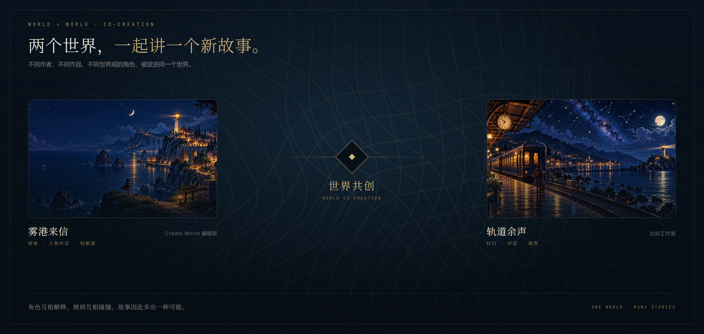



  

 

# 产品介绍

**Create World · 从故事出发，让世界延伸**

AI 游戏创作平台 & 游戏共创社区 · 2D 像素剧情游戏

 

---

## 一句话

> **把喜欢的故事，做成可以走进去的世界。**

Create World 是一个面向 **IP 粉丝、同人创作者、独立开发者与 IP / 品牌方** 的 AI 游戏创作平台。
你描述一个 IP、一段故事或一个世界设定，平台把它做成一款 **2D 像素剧情游戏**：
有场景、有角色、有对白、有选择、有结局；可以继续改，可以发布，可以被别人二创。

我们当前只做一件事，并把它做深：**2D 像素剧情游戏**。

---

## 产品短片

> 2 分 30 秒，从一句话到一款能玩的作品。带字幕，建议开声音。

https://github.com/user-attachments/assets/3c77994a-eac7-449b-a0c1-e046e7b2382d

也可以在 [在线体验](https://createworld.games) 里直接玩到片中的作品。

 

  

---

## 为什么是现在

故事类内容从不缺观众，缺的是「参与进去」的方式。

| 信号 | 数字 | 说明 |
| --- | --- | --- |
| 故事消费的规模 | **6.62 亿** | 中国微短剧用户规模（截至 2024.12，中国网络视听协会） |
| 成熟 IP 的创作热度 | **8.4 万达人 / 38.2 万作品** | 《甄嬛传》相关内容案例统计（数说故事） |
| 想创作，但不会做 | **54.6%** 曾有游戏创作想法，**58.9%** 无游戏相关创作经历 | 伽马数据《中国游戏产业 AIGC 发展前景报告》（2023） |

三组数据的口径不同，不能相加成市场规模。它们只说明一件事：
**「想把自己喜欢的故事做成游戏」的需求真实存在，而制作门槛把它挡在了门外。**

Create World 切入的，就是这道门槛。

---

## 产品是什么

平台连接四个环节，形成闭环：

<table>
<tr>
<td width="50%" valign="top">

### 01 · AI 游戏制作

仅需描述 IP、故事与世界设定，一键生成 2D 像素风剧情游戏，并支持持续修改。

- 支持一句话 / 全文 / Markdown / SRT / YAML
- 默认目标：约 10 分钟、至少 5 个场景
- 保留人物核心动机、关键因果与原结局
- 补写内容单独标注为原创

</td>
<td width="50%" valign="top">

### 02 · 插件生态

开发者上传 Skill、工具、工作流与素材包，拓展制作能力，提高平台 Agent 的质量上限。

- 做游戏的经验变成可复用的能力
- 平台推荐优质插件
- 插件权益融入订阅，而不是单独买卖

</td>
</tr>
<tr>
<td valign="top">

### 03 · 社区分享与二创

支持创作者一键发布作品、获得反馈、持续迭代；通过平台推荐，让优质作品获得更多曝光。

- 作品有自己的世界页
- 评论、收藏、二创入口
- 「基于这个世界，再做一款」

</td>
<td valign="top">

### 04 · 多 IP 世界共创

把不同游戏世界融入同一作品，共塑世界观，拓展剧情与娱乐形式。

- 角色互相解释，规则互相碰撞
- 联动、番外、跨世界叙事
- 让世界成为可以继续生长的东西

</td>
</tr>
</table>

 

  

---

## 为谁创造价值

<table>
<tr>
<td width="33%" valign="top">

### IP 粉丝与同人创作者

**想要**：围绕喜欢的角色、故事和世界观创作，与同好分享。

**平台价值**：AI 降低制作门槛，支持分享、二创与世界共创。

</td>
<td width="33%" valign="top">

### 个人创作者 / 独立开发者

**想要**：提高制作效率，获得作品曝光与商业化渠道。

**平台价值**：打通制作、发布与反馈，提供工具、插件与商业服务。

</td>
<td width="33%" valign="top">

### IP 方 / 品牌方

**想要**：把 IP 延展为互动内容，连接粉丝，推广品牌与产品。

**平台价值**：IP 共创、定制游戏、短视频链接挂载与游戏内推广。

</td>
</tr>
</table>

---

## 产品长什么样

  

<b>创作入口</b> —— 不用先学会写提示词，写你想看的那个画面就够了。

 

  

<b>游戏世界</b> —— 作品上架后有自己的世界页：封面、标签、试玩、二创。

 

  

<b>插件市场</b> —— 把「怎么做好」变成别人可以直接装上的能力。

 

  

<b>工作台</b> —— 制作、试玩、素材、版本在同一屏；失败不覆盖可玩版本。

 

  

<b>真的能玩</b> —— 场景、角色、对白、地图、交互、存档，都在运行时里真实存在。

---

## 和已有的工具，有什么不同

| 你现在的选择 | 它擅长什么 | 你的难点 | Create World 的选择 |
| --- | --- | --- | --- |
| **RPG Maker** | 地图、角色、对话与任务编辑 | 需要学编辑器与游戏逻辑；剧情、场景、互动要自己组织；分支改动要逐项配置 | 从自然语言开始，AI 完成剧情、场景与互动；用一句话持续修改，配合流程检查 |
| **Rosebud AI** | 对话生成、修改、分享与二创 | 收费与生成消耗较高；产出质量参差；作品彼此独立，跨世界共创受限 | 做深 2D 像素剧情，用流程与资源复用控制成本；把不同世界放进同一个故事 |
| **itch.io** | 发布、下载 / 在线玩、销售与数据 | 制作要靠别的工具；反馈与修改分散；世界联动要另外开发 | 制作、发布、反馈、二创在同一个平台；作品是下一个世界的入口 |

功能依据各产品官方资料；Rosebud 的难点为团队体验观察，属于定性判断。Create World 的成本与质量改善仍在通过内测量化。

---

## 商业模式

> 当前处于内测阶段，尚未产生付费订单。以下为验证方向，不是已实现的收入。

<table>
<tr>
<td width="33%" valign="top">

### 01 创作订阅与用量

**谁付费**：创作者、开发者与工作室

**买什么**：AI 生成与修改、专业工具、订阅内的插件与创作资源

**怎么收**：订阅费 + 额外用量

</td>
<td width="33%" valign="top">

### 02 IP / 品牌商业服务

**谁付费**：IP 方、品牌方与内容平台

**买什么**：定制游戏、粉丝互动内容、短视频链接挂载与游戏内推广

**怎么收**：项目费 / 持续服务费 / 按约定分成

</td>
<td width="33%" valign="top">

### 03 作品交易与支持

**谁付费**：作品购买者与创作者支持者

**买什么**：游戏、章节、扩展内容，以及打赏

**怎么收**：交易服务费 / 分成

</td>
</tr>
</table>

初期优先验证订阅与 IP 定制服务，作品交易随内容供给成熟而扩大。现阶段不承诺具体定价、抽成比例或订单规模。

---

## 现在进行到哪

<table>
<tr>
<td align="center" width="25%"><h3>100+</h3>内测意向用户</td>
<td align="center" width="25%"><h3>100+</h3>社群成员</td>
<td align="center" width="25%"><h3>5</h3>已上架世界</td>
<td align="center" width="25%"><h3>18</h3>制作技能</td>
</tr>
</table>

- 《三体》由已获内测权限的用户基于平台全自动化创作；相关 IP 商业合作尚未确认。
- 《高墙之外》《雾港来信》《山风归途》《轨道余声》《尘埃之外》等作品已完成制作或上架。
- 产品根据核心用户反馈每日迭代。

**下一步**

- [ ] 完善后台并发调度、API 稳健性与异常恢复
- [ ] 从内测意向群与核心社群分批开放灰度
- [ ] 持续修复生成、修改、运行与社区反馈中的问题
- [ ] 验证稳定性后，准备区域性更大范围上线
- [ ] 并行推进 IP 共创、定制与推广试点

内测用户与社群成员两类群体可能重合，不合并计算。

---

## 团队

**CW Team** · 太原理工大学 · 4 人

- 3 人 · 计算机科学与技术（211）
- 1 人 · 数字媒体艺术
- 分工覆盖：产品与运营、系统开发、AI 链路优化、美术与 UI/UX

**做过的事**

- 2026 字节跳动抖音 AI 创变者比赛 · 全国决赛二等奖
- 天津某政企单位 AI 会议室系统 · 一个月内交付
- 西安某餐饮企业「知膳 AI」系统 · 多门店交付

---

### 从一个念头开始

[**在线体验**](https://createworld.games) &nbsp;·&nbsp; [**插件市场**](https://createworld.games/#/plugins) &nbsp;·&nbsp; [**游戏世界**](https://createworld.games/#/games) &nbsp;·&nbsp; [**返回 README**](README.md)

 

© 2026 CW Team · 产品数据由项目方提供 · 第三方 IP 作品为内测用户二创 demo

