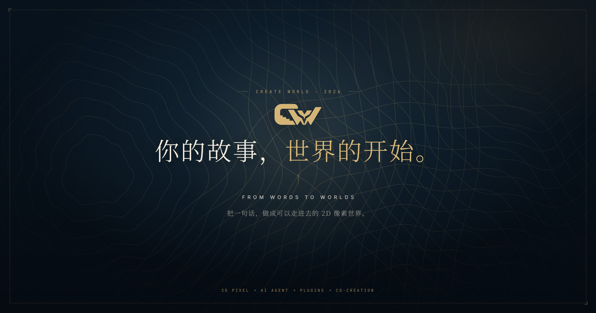

<div align="center">
  
</div>

<br/>

<div align="center">

**AI game creation platform · 2D pixel narrative games**

Create World turns a sentence, a novel or an episode script into a playable 2D pixel narrative game.
Scenes, characters, dialogue, choices and endings are part of the build. You can keep editing it, and publish it when it is ready.

<sub>AI game creation · 2D pixel narrative · plugin ecosystem · world co-creation</sub>

<br/>

[](https://createworld.games)
[](PRODUCT.md)
[](create-world-workbench/package.json)
[](LICENSE)

<br/>

[**Play online**](https://createworld.games) &nbsp;·&nbsp; [**Product intro**](PRODUCT.md) &nbsp;·&nbsp; [**Film**](#film) &nbsp;·&nbsp; [**Quick start**](#quick-start) &nbsp;·&nbsp; [**中文**](README.md)

</div>

<br/>

---

## FILM

A 2:30 product film with subtitles.

https://github.com/user-attachments/assets/04df0dd9-7341-461d-b7ec-2a46d0729d8b

<sub>Hosted by GitHub. Plays inline.</sub>

---

## OVERVIEW

The hard part of making a game is usually the pipeline, not the code. Moving from a story to something playable requires adaptation, storyboards, art, dialogue, interaction, build, testing and fixes.

Create World hands that pipeline to an AI team that organises its own work: it splits the story into scenes, produces pixel assets, wires up interaction, and runs acceptance in a real browser. The output is a game you can run, plus a content archive you can keep editing.

<table>
<tr>
<td width="50%" valign="top">

**Use cases**

- Turning a story into a playable work
- Writing a side story for an existing character
- Converting IP or brand content into an interactive experience
- Packaging game-making practice as a reusable plugin

</td>
<td width="50%" valign="top">

**Current scope**

- No one-click generation of AAA-scale games
- No open-world sandbox; 2D pixel narrative only
- Does not replace the creator's judgment on the core story
- AI-generated and original content are labelled separately

</td>
</tr>
</table>

---

## WORKFLOW

<table>
<tr>
<td width="33%" valign="top" align="center">

### 01 · Input

A sentence, a synopsis, a single episode, an SRT file, or a structured YAML archive.

<sub>`Example: turn the best part of The Three-Body Problem into a game.`</sub>

</td>
<td width="33%" valign="top" align="center">

### 02 · Production

The agent adapts the story, designs mechanics, paints scenes, writes dialogue, builds the runtime, and runs acceptance in a real browser.

<sub>`Target: ~10 minutes · at least 5 scenes`</sub>

</td>
<td width="33%" valign="top" align="center">

### 03 · Delivery

Play it, revise it by instruction, switch versions, export a static HTML5 build, or publish it for fan works.

<sub>`WASD · E · mobile landscape`</sub>

</td>
</tr>
</table>

<div align="center">
  
</div>

---

## PRODUCT

Screens from the live product. Click one to open the page.

<div align="center">
  <a href="https://createworld.games"></a>
</div>
<div align="center"><sub><b>Creation entry</b> — start with one sentence; the system confirms the request before production.</sub></div>

<br/>

<div align="center">
  <a href="https://createworld.games/#/games"></a>
</div>
<div align="center"><sub><b>Worlds</b> — each work has a world page with cover, tags, playtest and fan-work entry.</sub></div>

<br/>

<div align="center">
  <a href="https://createworld.games/#/plugins"></a>
</div>
<div align="center"><sub><b>Plugins</b> — skills, tools, workflows and asset packs that install into another creator's workbench.</sub></div>

<br/>

<div align="center">
  
</div>
<div align="center"><sub><b>Workbench</b> — edit on the left, play on the right. Each revision creates a version; a build that fails acceptance never replaces the current playable version.</sub></div>

<br/>

<div align="center">
  
</div>
<div align="center"><sub><b>Playtest</b> — scenes, characters, dialogue, map, interaction and saves are provided by the runtime.</sub></div>

---

## CAPABILITIES

| Capability | Problem addressed | What it delivers |
| --- | --- | --- |
| **AI game production** | The full pipeline between an idea and a work | A playable 2D pixel narrative game from an IP, story or world setting, with ongoing edits |
| **Plugin ecosystem** | Production practice is hard to reuse | Skills, tools, workflows and asset packs that can be published, reused and recommended |
| **Community & fan works** | A published work has no follow-through | Publishing, feedback, version iteration, and fan works built on the same world |
| **World co-creation** | Works stay isolated from one another | Characters and settings from different works in one world, with crossovers and spin-offs |

<br/>

<div align="center">
  
</div>

---

## WORLDS

Works that are live or in closed beta.

| World | Genre | Status | Summary |
| --- | --- | :--: | --- |
| **The Three-Body Problem · Dark Forest** | Sci-fi / narrative exploration | Playable | Enter the Dark Forest from Luo Ji's perspective |
| **Beyond the High Walls** | Adventure / puzzle | Playable | The wall traps your steps, not your hope |
| **Letters from Fog Harbor** | Exploration / light puzzle | Playable | A lighthouse, and a letter never sent |
| **Mountain Wind, Way Home** | Travel / narrative | Showcase | Follow the old map back into memory |
| **Echoes on the Track** | Sci-fi / investigation | Playable | After the signal dies, someone still waits |
| **Beyond the Dust** | Sci-fi / two scenes | Runnable | A standalone game based on the opening of Interstellar, running on our engine |

<br/>

<details>
<summary><b>On world co-creation</b></summary>

<br/>

A co-created work places characters and settings from different works inside one rule set. Its value is not the combination of settings, but the narrative space created when two worldviews have to explain each other.

Examples include Sun Wukong in the Grand View Garden, Marvel heroes arriving at Three-Body civilisation, and ChatGPT meeting the Jenny spinning machine.

> Covers and settings for co-created works are supplied by the creators; the platform turns them into playable scenes and interaction.

</details>

---

## ARCHITECTURE

The pipeline has six checkable stages, each leaving a reviewable record.

```text
        sentence / novel / script / SRT / YAML
                        │
                        ▼
   ┌──────────────────────────────────────────────┐
   │  content understanding & adaptation          │  ←→  18 production skills
   │  motives · causality · original ending       │
   └──────────────────┬───────────────────────────┘
                      ▼
   ┌──────────────────────────────────────────────┐
   │  gameplay & scene design                     │  ←→  YAML content archive
   │  state machine · event windows               │      (single source of truth)
   └──────────────────┬───────────────────────────┘
                      ▼
   ┌──────────────────────────────────────────────┐
   │  pixel asset production                      │  ←→  masters · provenance · checks
   │  unified art direction · 4-direction walk    │
   └──────────────────┬───────────────────────────┘
                      ▼
   ┌──────────────────────────────────────────────┐
   │  compile & build                             │  ←→  static HTML5 game
   │  scenes · collision · saves                  │      (no backend needed)
   └──────────────────┬───────────────────────────┘
                      ▼
   ┌──────────────────────────────────────────────┐
   │  real-browser acceptance (Playwright)        │  ←→  advance / fail / cancel /
   │  keyboard, mouse, touch                      │      refresh / save restore
   └──────────────────┬───────────────────────────┘
                      ▼
   ┌──────────────────────────────────────────────┐
   │  review & accept: only a fully evidenced      │
   │  build replaces the current playable version  │
   └──────────────────────────────────────────────┘
```

<details>
<summary><b>Tech stack</b></summary>

<br/>

| Layer | Choice | Purpose |
| --- | --- | --- |
| Web | **React 19 + Vite 7 + TypeScript 5.9** | One UI and design language for studio, community and marketplace |
| Server | **Node.js 24 + tsx + SQLite** | Local-first; projects, runs, versions and evidence in one store |
| Agent | **Codex App Server + 18 skills** | The model selects skills and order; no fixed pipeline |
| Content | **YAML content spec + scene slicing** | Stable IDs for scenes, events, characters, state and mechanics |
| Assets | **Pillow / native image generation + deterministic checks** | Masters, provenance and checks stored together |
| Acceptance | **Playwright (Chromium / Firefox / WebKit)** | Real input covering advance, fail, cancel, refresh and save restore |
| Delivery | **Static HTML5 export** | Runs without Codex, the workbench or any backend |

</details>

<details>
<summary><b>Acceptance and evidence</b></summary>

<br/>

| Stage | Evidence |
| --- | --- |
| Content contract | Stable IDs for scenes, events, characters, state and mechanics; machine-checkable |
| Build | Compile output bound to an asset manifest |
| Playtest | Real keyboard, mouse and touch input covering advance, fail, cancel, refresh and save restore |
| Review | Actual inspection of on-screen visuals, mechanics and text |
| Version | A version is accepted only when build, assets, playtest and review records are complete |

Acceptance is based on actual playability: only fully evidenced versions are accepted, and a failed candidate never replaces the current playable version.

</details>

---

## QUICK START

**A. Front-end demo (no backend)**

```bash
git clone https://github.com/Leizhidong-creator/CreateWorld.git
cd CreateWorld/create-world-workbench
npm ci
npm run build
npx serve dist/web
```

Projects, edits and versions are stored in the browser's localStorage. Demo account: `creator` / `createworld`.

**B. Full workbench (requires a local Codex CLI)**

```bash
cd CreateWorld/create-world-workbench
npm ci
npm run build
npm start              # http://127.0.0.1:8787
```

> Requirements: Node.js 24+, a signed-in Codex CLI, Python 3. See the
> [workbench README](create-world-workbench/README.md) and [architecture](create-world-workbench/docs/ARCHITECTURE.md).

**C. Run an exported game**

```bash
cd CreateWorld/interstellar-dust
npm start              # http://127.0.0.1:4173
```

Exported games are plain static HTML5: unzip and run `python3 -m http.server 8000`. No model, backend or network required.

<br/>

<details>
<summary><b>Repository layout</b></summary>

<br/>

```text
CreateWorld/
├─ create-world-workbench/          # Workbench: React front end, Node server, agent orchestration
│  ├─ apps/web/                     # Community, worlds, plugin market, workbench
│  ├─ apps/server/                  # Local API, SQLite, SSE
│  ├─ packages/orchestrator/        # Task lifecycle, tool runtime, candidates, revisions
│  ├─ packages/runtime/             # Scene transitions, state, saves
│  ├─ packages/compiler/            # Content → playable game compilation
│  ├─ packages/assets/              # Asset production, validation, caching
│  ├─ packages/browser-runner/      # Real browser operation and state observation
│  └─ content-spec/                 # 2D pixel narrative content spec (YAML)
├─ interstellar-dust/               # Beyond the Dust: standalone playable pixel game
├─ .agents/skills/                  # 18 production skills
├─ docs/                            # Architecture, acceptance and engineering notes
├─ assets/                          # Brand and product assets used by README / PRODUCT
└─ PRODUCT.md                       # Product introduction
```

</details>

---

## STATUS

<table>
<tr>
<td align="center" width="25%">

### 100+

**Beta prospects**

Expressed interest in testing

</td>
<td align="center" width="25%">

### 100+

**Community members**

Providing feedback and requests

</td>
<td align="center" width="25%">

### 5

**Live works**

Sci-fi, mystery, travel, puzzle

</td>
<td align="center" width="25%">

### 18

**Production skills**

From art direction to acceptance

</td>
</tr>
</table>

<br/>

**Progress and plan**

- [x] Front-end experience live at `createworld.games`
- [x] Full production runs for *The Three-Body Problem* and *Beyond the High Walls*
- [x] Plugin market, co-creation pages and workbench versioning
- [ ] Backend concurrency and failure recovery
- [ ] Staged closed beta
- [ ] Commercial pilots: subscription, IP commissions, marketplace

<sub>Beta figures are provided by the team; the two groups may overlap.</sub>

---

---

<div align="center">

**Create World** · FROM WORDS TO WORLDS

<br/>

[Website](https://createworld.games) &nbsp;·&nbsp; [Product intro](PRODUCT.md) &nbsp;·&nbsp; [GitHub](https://github.com/Leizhidong-creator/CreateWorld) &nbsp;·&nbsp; [Email](mailto:3290659791@qq.com)

<br/>

<sub>© 2026 CW Team. All rights reserved. Source code and assets are proprietary; commercial use or redistribution requires prior written permission.</sub>
<sub>Works based on third-party IP are fan-made demos by beta users. All rights remain with their respective rights holders; removal on request.</sub>

</div>

