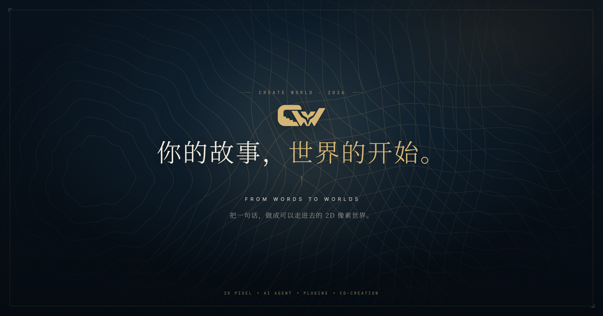
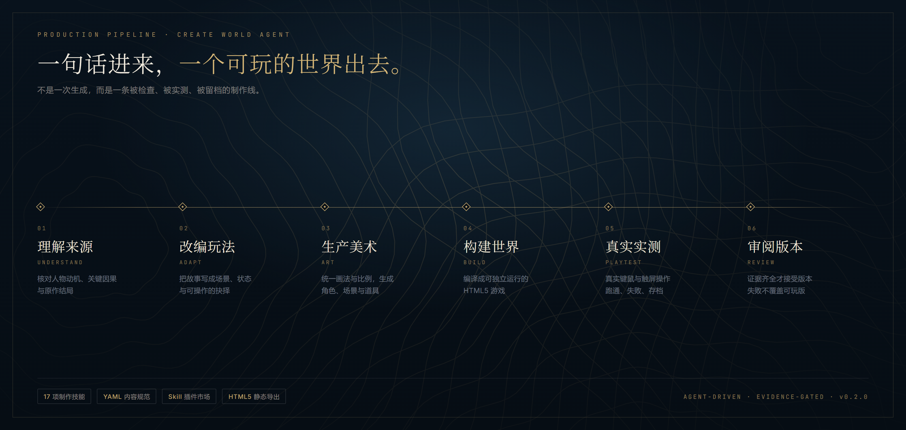
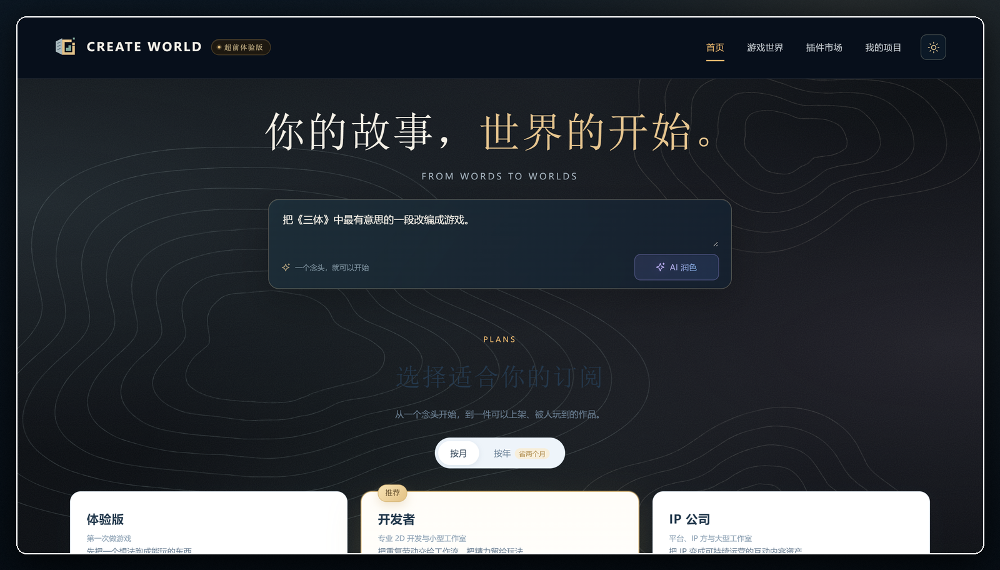
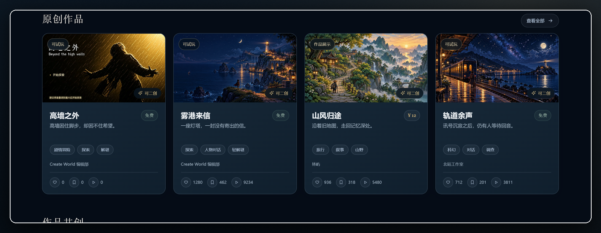
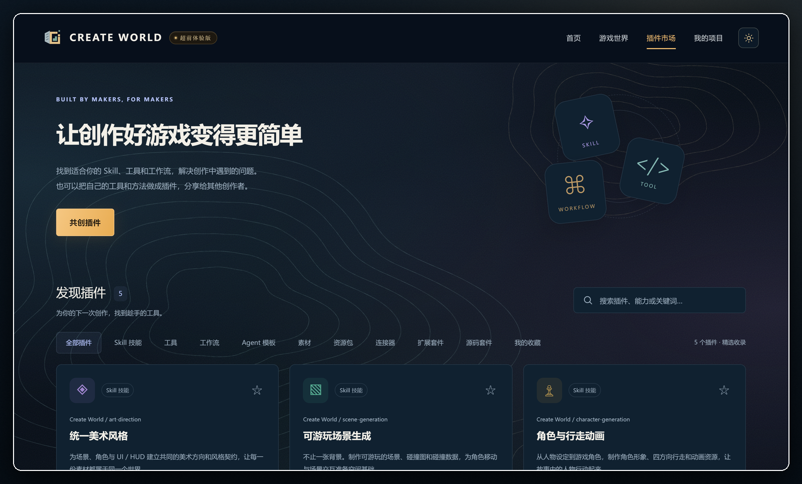
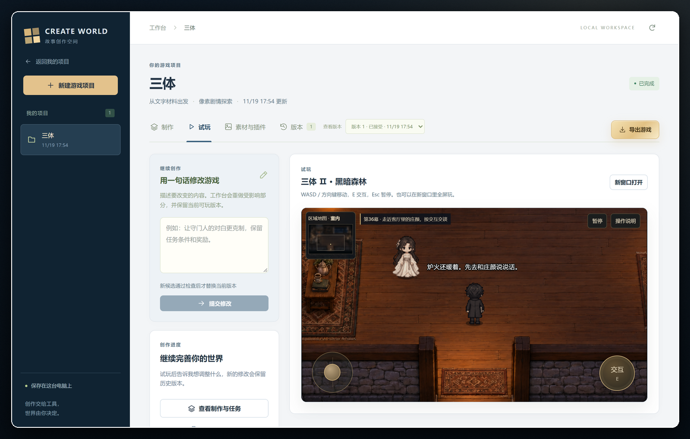
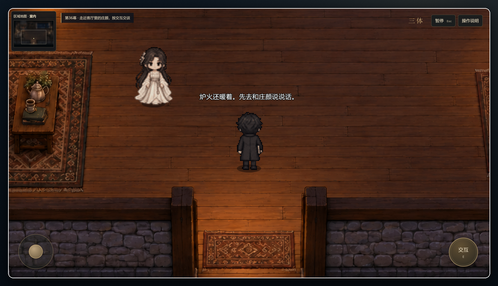
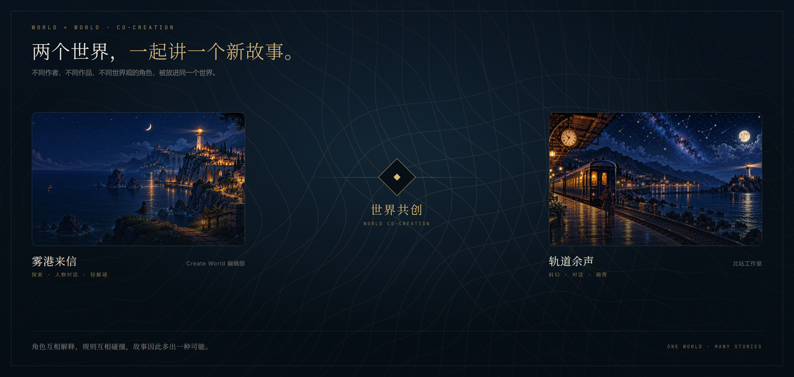

<div align="center">
  
</div>

<br/>

<div align="center">

**Turn a single sentence into a world you can walk into.**

`Create World` is an AI game-creation platform.
Give it a sentence, a novel, a script or a subtitle file —
it gives you a **playable 2D pixel narrative game** you can keep editing and publish.

<sub>AI game creation · 2D pixel narrative · plugin ecosystem · world co-creation</sub>

<br/>

[](https://createworld.games)
[](PRODUCT.md)
[](create-world-workbench/package.json)
[](LICENSE)

<br/>

[**▶ Play online**](https://createworld.games) &nbsp;·&nbsp; [**Product intro**](PRODUCT.md) &nbsp;·&nbsp; [**Watch the film**](#-the-film) &nbsp;·&nbsp; [**Run it locally**](#-run-it-locally) &nbsp;·&nbsp; [**中文**](README.md)

</div>

<br/>

---

## 🎬 The film

> Two and a half minutes, from one sentence to a playable work. Subtitled — sound on.

__VIDEO_URL__

<sub>Hosted by GitHub, so it plays right here — no redirect to YouTube.</sub>

---

## What it is

> **What you write is not a prompt. It is the first line of a world.**

Most people never finish a game — not because they cannot code, but because between "an idea" and "something playable" sits an entire production line: adaptation, storyboarding, art, dialogue, interaction, build, test, bug-fixing.

Create World hands that line to an AI team that organises its own work. You describe the world you want; it turns the story into scenes, paints the scenes as pixels, wires the pixels to interaction, and runs the result — then gives you a game you can open in a browser.

<table>
<tr>
<td width="50%" valign="top">

**Built for**

- People who love a story and want to walk inside it
- Fan creators writing an alternate ending for a character
- IP owners and brands turning content into interaction
- Developers who want their craft to become a reusable plugin

</td>
<td width="50%" valign="top">

**Not**

- A magic button for AAA games
- An open-world sandbox — we focus on **2D pixel narrative**
- A replacement for your story decisions
- Hiding AI: original text, inference and added content are labelled separately

</td>
</tr>
</table>

---

## Three steps

| 01 · Write | 02 · Generate | 03 · Walk in |
| --- | --- | --- |
| One sentence, a synopsis, an episode, an SRT file, or a structured YAML archive. | An AI agent reads the story, designs the mechanics, paints the scenes, writes dialogue, builds the runtime, and playtests it in a real browser. | Play it, change it with a sentence, switch versions, export a static HTML5 build, or publish it and let others walk in. |

<div align="center">
  
</div>

---

## The product

> Real screens from the live product. Click to open the corresponding page.

<div align="center">
  <a href="https://createworld.games"></a>
</div>
<div align="center"><sub><b>Creation entry</b> — one sentence is enough; AI first helps you say what you mean.</sub></div>

<br/>

<div align="center">
  <a href="https://createworld.games/#/games"></a>
</div>
<div align="center"><sub><b>Worlds</b> — not a gallery of model demos, but worlds people have played.</sub></div>

<br/>

<div align="center">
  <a href="https://createworld.games/#/plugins"></a>
</div>
<div align="center"><sub><b>Plugins</b> — the know-how of making a good game, packaged as reusable capability.</sub></div>

<br/>

<div align="center">
  
</div>
<div align="center"><sub><b>Workbench</b> — edit on the left, play on the right; every change is a version, and a failed build never replaces a playable one.</sub></div>

<br/>

<div align="center">
  
</div>
<div align="center"><sub><b>Actually playable</b> — scenes, characters, dialogue, map, interaction and saves really exist at runtime.</sub></div>

---

## Four loops

| | Capability | What it solves | What you get |
| :--: | --- | --- | --- |
| ◆ | **AI game making** | The production line between "idea" and "work" | Describe an IP, story or world; get a playable 2D pixel narrative game and keep editing it in natural language |
| ◆ | **Plugin ecosystem** | Good practice stuck in one person's head | Skills, tools, workflows and asset packs can be published, reused and recommended |
| ◆ | **Community & fan works** | A finished work goes nowhere | One-click publishing, feedback, iteration, and "build another game on top of this world" |
| ◆ | **World co-creation** | Every game is an island | Put characters and settings from different works into one world: crossovers, spin-offs, cross-world narrative |

<br/>

<div align="center">
  
</div>

---

## Worlds

> Not renders — works that are live or in closed beta.

| World | Genre | Status | One line |
| --- | --- | :--: | --- |
| **The Three-Body Problem · Dark Forest** | Sci-fi / narrative exploration | Playable | Step into the Dark Forest as Luo Ji |
| **Beyond the High Walls** | Adventure / puzzle | Playable | The wall traps your steps, not your hope |
| **Letters from Fog Harbor** | Exploration / light puzzle | Playable | A lighthouse, and a letter never sent |
| **Mountain Wind, Way Home** | Travel / narrative | Showcase | Follow the old map back into memory |
| **Echoes on the Track** | Sci-fi / investigation | Playable | After the signal dies, someone still waits |
| **Beyond the Dust** | Sci-fi / two scenes | Runnable | A standalone short game built on our runtime |

---

## How it works

```text
        sentence / novel / script / SRT / YAML
                        │
                        ▼
   ┌──────────────────────────────────────────────┐
   │  content understanding & adaptation          │  ←→  18 production skills
   │  motives · causality · original ending       │
   └──────────────────┬───────────────────────────┘
                      ▼
   ┌──────────────────────────────────────────────┐
   │  gameplay & scene design                     │  ←→  YAML content archive
   │  state machine · event windows               │      (single source of truth)
   └──────────────────┬───────────────────────────┘
                      ▼
   ┌──────────────────────────────────────────────┐
   │  pixel asset production                      │  ←→  masters · provenance · checks
   │  unified art direction · 4-direction walk    │
   └──────────────────┬───────────────────────────┘
                      ▼
   ┌──────────────────────────────────────────────┐
   │  compile & build                             │  ←→  static HTML5 game
   │  scenes · collision · saves                  │      (no backend needed)
   └──────────────────┬───────────────────────────┘
                      ▼
   ┌──────────────────────────────────────────────┐
   │  real-browser playtest (Playwright)          │  ←→  advance / fail / cancel /
   │  keyboard, mouse, touch                      │      refresh / save restore
   └──────────────────┬───────────────────────────┘
                      ▼
   ┌──────────────────────────────────────────────┐
   │  review & accept: only a fully evidenced      │
   │  build replaces the current playable version  │
   └──────────────────────────────────────────────┘
```

<details>
<summary><b>◆ Tech stack in ten seconds</b></summary>

<br/>

| Layer | Choice | Why |
| --- | --- | --- |
| Web | **React 19 + Vite 7 + TypeScript 5.9** | One UI language across studio, community and marketplace |
| Server | **Node.js 24 + tsx + SQLite** | Local-first; projects, runs, versions and evidence in one place |
| Agent | **Codex App Server + 18 skills** | The model decides what to read and in which order |
| Content | **YAML content spec + scene slicing** | Stable IDs for scenes, events, characters, state and mechanics |
| Assets | **Pillow / native image generation + deterministic checks** | Masters, provenance and checks are stored together |
| QA | **Playwright (Chromium / Firefox / WebKit)** | Real input, real save restore, real failure paths |
| Delivery | **Static HTML5 export** | Play it with `python -m http.server`; no model, no backend |

</details>

---

## Run it locally

**A. Front-end demo only (no backend)**

```bash
git clone https://github.com/Leizhidong-creator/CreateWorld.git
cd CreateWorld/create-world-workbench
npm ci
npm run build
npx serve dist/web
```

Everything is stored in your browser's localStorage. Demo account: `creator` / `createworld`.

**B. Full workbench (needs a logged-in Codex CLI)**

```bash
cd CreateWorld/create-world-workbench
npm ci
npm run build
npm start              # http://127.0.0.1:8787
```

**C. Play an exported game**

```bash
cd CreateWorld/interstellar-dust
npm start              # http://127.0.0.1:4173
```

Requirements: Node.js 24+, a logged-in Codex CLI, Python 3. See the
[workbench README](create-world-workbench/README.md) and [architecture](create-world-workbench/docs/ARCHITECTURE.md).

---

## Traction

| 100+ beta users | 100+ community | 5 live worlds | 18 skills |
| :--: | :--: | :--: | :--: |

**Next**

- [x] Front-end experience live at `createworld.games`
- [x] Full production runs for *The Three-Body Problem* and *Beyond the High Walls*
- [ ] Backend concurrency, scheduling and recovery
- [ ] Staged closed beta
- [ ] Commercial pilots: subscription / IP commissions / marketplace

<sub>Beta figures are provided by the team; the two groups may overlap.</sub>

---

## Team

**CW Team** · Taiyuan University of Technology · 4 people

- 3 × Computer Science (Project 211), 1 × Digital Media Art
- Product, agent pipeline, systems and UI/UX

**Selected work**

- 2026 ByteDance Douyin AI Innovator Competition — National Final, 2nd Prize
- AI meeting-room system delivered to a government/enterprise client in one month
- "Zhi Shan AI" restaurant operations system, delivered across multiple stores

---

## A small easter egg

<details>
<summary><b>◆ Open it and get a world seed</b></summary>

<br/>

```text
        ██████╗██╗    ██╗
       ██╔════╝██║    ██║
       ██║     ██║ █╗ ██║
       ██║     ██║███╗██║
       ╚██████╗╚███╔███╔╝
        ╚═════╝ ╚══╝╚══╝     create world

  SEED     0x7A3F-2026
  WORLD    Fog Harbor
  WEATHER  light rain, the lighthouse is on
  FIRST    "Go and read that letter."
```

Run `node scripts/seed.mjs` in the repo and you will get yours.

</details>

---

<div align="center">

### Your story. The beginning of a world.

<sub>FROM WORDS TO WORLDS</sub>

<br/>

[Website](https://createworld.games) &nbsp;·&nbsp; [Product intro](PRODUCT.md) &nbsp;·&nbsp; [GitHub](https://github.com/Leizhidong-creator/CreateWorld) &nbsp;·&nbsp; [Email](mailto:3290659791@qq.com)

<br/>

<sub>© 2026 CW Team. Source and assets are proprietary; please do not redistribute commercially.</sub>
<sub>Works based on third-party IP are fan-made demos by beta users. All rights belong to their respective owners.</sub>

</div>
