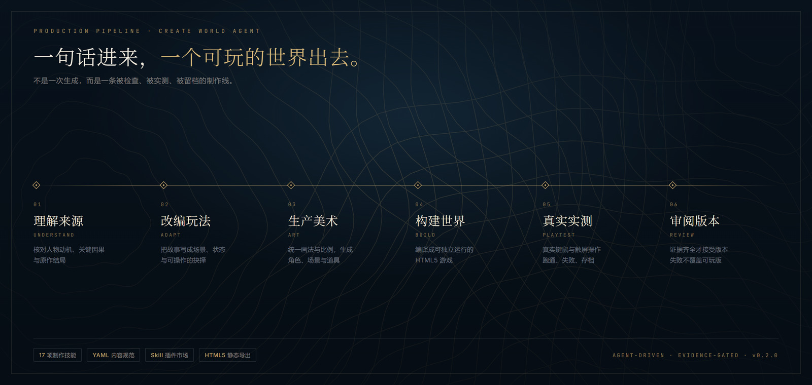
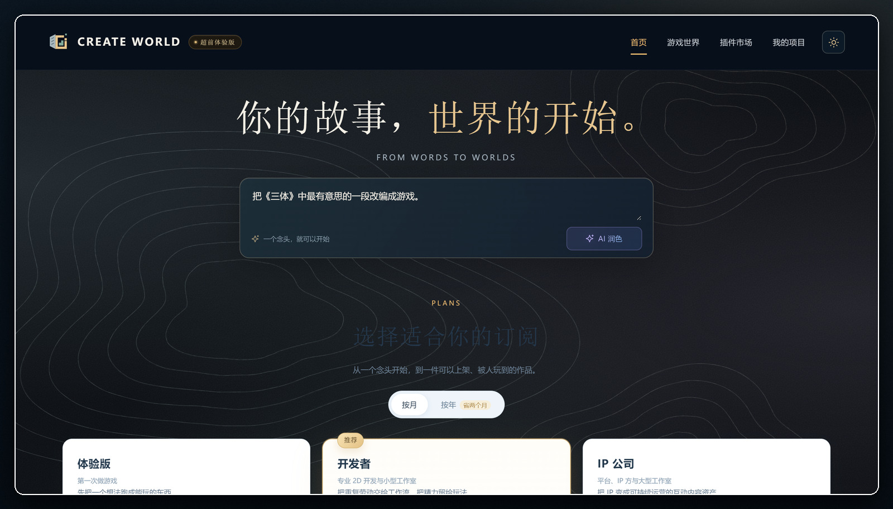
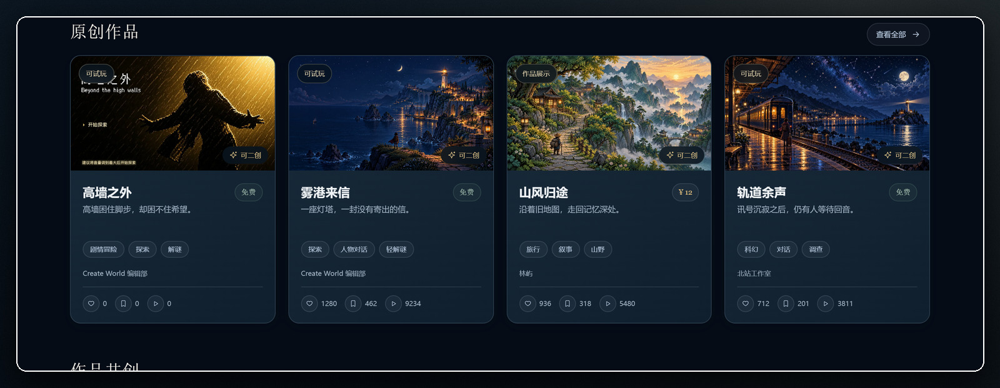
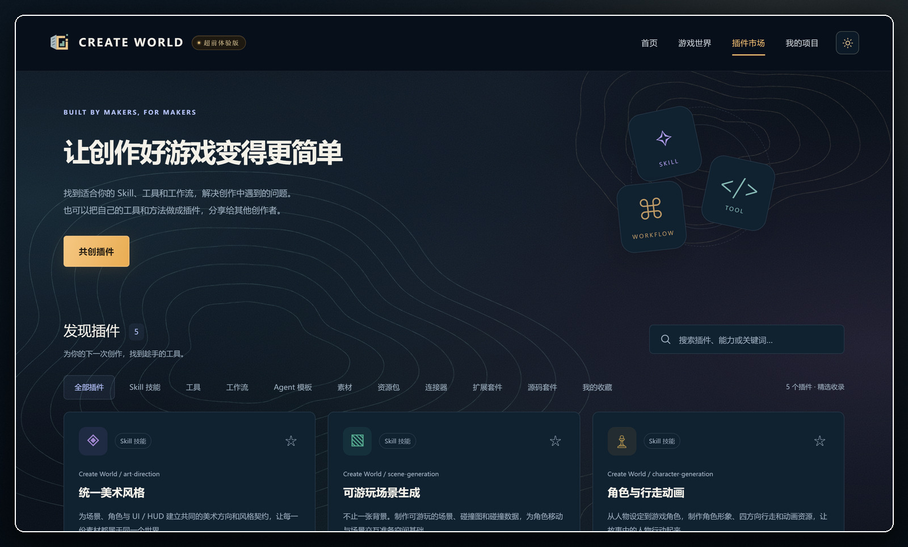
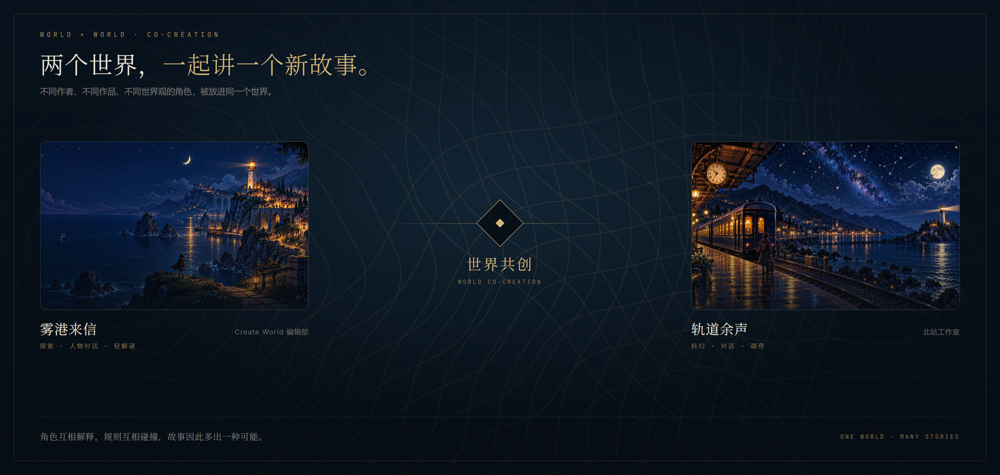

<div align="center">
  
</div>

<br/>

<div align="center">

**From a story to a world you can play.**

Create World is an AI game-creation platform.
Give it a sentence, a novel or an episode script, and it makes a playable **2D pixel narrative game**:
scenes, characters, dialogue, choices and endings. You can keep editing it, and publish it when it is ready.

<sub>AI game creation · 2D pixel narrative · plugin ecosystem · world co-creation</sub>

<br/>

[](https://createworld.games)
[](PRODUCT.md)
[](create-world-workbench/package.json)
[](LICENSE)

<br/>

[**Play online**](https://createworld.games) &nbsp;·&nbsp; [**Product intro**](PRODUCT.md) &nbsp;·&nbsp; [**The film**](#the-film) &nbsp;·&nbsp; [**Run it locally**](#run-it-locally) &nbsp;·&nbsp; [**中文**](README.md)

</div>

<br/>

---

## The film

> Two and a half minutes. The first half is the game; the second half is how it gets made. Subtitled.

https://github.com/user-attachments/assets/3c77994a-eac7-449b-a0c1-e046e7b2382d

<sub>Hosted by GitHub. Click and it plays.</sub>

---

## What it is

Making a game is rarely hard because of code.

It is hard because of the line between a story and something playable: adaptation, storyboards, art, dialogue, interaction, build, test, bug-fixing. Every step needs a person, and every step can stall.

Create World hands that line to an AI team that organises its own work. You describe the world you want. It turns the story into scenes, paints the scenes as pixels, wires the pixels to interaction, and runs the result in a real browser. What you get is a game you can open and play, plus a path to keep changing it.

<table>
<tr>
<td width="50%" valign="top">

**Built for**

- People with a story they want to walk into
- Fan creators writing an alternate path for a character
- IP owners and brands turning content into something interactive
- Developers who want their craft to become a plugin

</td>
<td width="50%" valign="top">

**Out of scope**

- A one-click button for AAA games
- Open-world sandboxes; we do 2D pixel narrative
- Deciding the core of your story for you
- Hiding AI: original text, inference and added content are labelled separately

</td>
</tr>
</table>

---

## Three steps

<table>
<tr>
<td width="33%" valign="top" align="center">

### 01 · Write

A sentence, a synopsis, an episode, an SRT file, or a structured YAML archive.

<sub>`Turn the best part of The Three-Body Problem into a game.`</sub>

</td>
<td width="33%" valign="top" align="center">

### 02 · Generate

It reads the story, designs the mechanics, paints the scenes, writes dialogue, builds the runtime, and playtests it in a real browser.

<sub>`10 min · 5 scenes · pixel`</sub>

</td>
<td width="33%" valign="top" align="center">

### 03 · Walk in

Play it, change it with a sentence, switch versions, export a static HTML5 build — or publish it.

<sub>`WASD · E · mobile landscape`</sub>

</td>
</tr>
</table>

<div align="center">
  
</div>

---

## The product

> Real screens from the live product. Click one to open the page.

<div align="center">
  <a href="https://createworld.games"></a>
</div>
<div align="center"><sub><b>Creation entry</b> — one sentence is enough. It first makes sure it understands what you want.</sub></div>

<br/>

<div align="center">
  <a href="https://createworld.games/#/games"></a>
</div>
<div align="center"><sub><b>Worlds</b> — covers, tags, playtests, fan-work entries. Every work gets its own page.</sub></div>

<br/>

<div align="center">
  <a href="https://createworld.games/#/plugins"></a>
</div>
<div align="center"><sub><b>Plugins</b> — skills, tools, workflows and asset packs that install into someone else's workbench.</sub></div>

<br/>

<div align="center">
  
</div>
<div align="center"><sub><b>Workbench</b> — edit on the left, play on the right. Every change is a version; a failed build never replaces a playable one.</sub></div>

<br/>

<div align="center">
  
</div>
<div align="center"><sub><b>Playtest</b> — scenes, characters, dialogue, map, interaction and saves all exist at runtime.</sub></div>

---

## Four parts

| | Part | What it addresses | What you get |
| :--: | --- | --- | --- |
| ◆ | **AI game making** | The production line between an idea and a work | Describe an IP, story or world; get a playable 2D pixel narrative game and keep editing it in natural language |
| ◆ | **Plugin ecosystem** | Good practice stuck in one person's head | Skills, tools, workflows and asset packs that can be published, reused and recommended |
| ◆ | **Community & fan works** | A finished work goes nowhere | Publishing, feedback, iteration, and "build another game on top of this world" |
| ◆ | **World co-creation** | Every game is an island | Characters and settings from different works in one world: crossovers, spin-offs, cross-world narrative |

<br/>

<div align="center">
  
</div>

---

## Worlds

> Live or in closed beta. Not renders.

| World | Genre | Status | One line |
| --- | --- | :--: | --- |
| **The Three-Body Problem · Dark Forest** | Sci-fi / narrative exploration | Playable | Step into the Dark Forest as Luo Ji |
| **Beyond the High Walls** | Adventure / puzzle | Playable | The wall traps your steps, not your hope |
| **Letters from Fog Harbor** | Exploration / light puzzle | Playable | A lighthouse, and a letter never sent |
| **Mountain Wind, Way Home** | Travel / narrative | Showcase | Follow the old map back into memory |
| **Echoes on the Track** | Sci-fi / investigation | Playable | After the signal dies, someone still waits |
| **Beyond the Dust** | Sci-fi / two scenes | Runnable | A standalone short game built on our runtime |

---

## How it works

```text
        sentence / novel / script / SRT / YAML
                        │
                        ▼
   ┌──────────────────────────────────────────────┐
   │  content understanding & adaptation          │  ←→  18 production skills
   │  motives · causality · original ending       │
   └──────────────────┬───────────────────────────┘
                      ▼
   ┌──────────────────────────────────────────────┐
   │  gameplay & scene design                     │  ←→  YAML content archive
   │  state machine · event windows               │      (single source of truth)
   └──────────────────┬───────────────────────────┘
                      ▼
   ┌──────────────────────────────────────────────┐
   │  pixel asset production                      │  ←→  masters · provenance · checks
   │  unified art direction · 4-direction walk    │
   └──────────────────┬───────────────────────────┘
                      ▼
   ┌──────────────────────────────────────────────┐
   │  compile & build                             │  ←→  static HTML5 game
   │  scenes · collision · saves                  │      (no backend needed)
   └──────────────────┬───────────────────────────┘
                      ▼
   ┌──────────────────────────────────────────────┐
   │  real-browser playtest (Playwright)          │  ←→  advance / fail / cancel /
   │  keyboard, mouse, touch                      │      refresh / save restore
   └──────────────────┬───────────────────────────┘
                      ▼
   ┌──────────────────────────────────────────────┐
   │  review & accept: only a fully evidenced      │
   │  build replaces the current playable version  │
   └──────────────────────────────────────────────┘
```

<details>
<summary><b>◆ Tech stack in ten seconds</b></summary>

<br/>

| Layer | Choice | Why |
| --- | --- | --- |
| Web | **React 19 + Vite 7 + TypeScript 5.9** | One UI language across studio, community and marketplace |
| Server | **Node.js 24 + tsx + SQLite** | Local-first; projects, runs, versions and evidence in one place |
| Agent | **Codex App Server + 18 skills** | The model decides what to read and in which order; no fixed pipeline |
| Content | **YAML content spec + scene slicing** | Stable IDs for scenes, events, characters, state and mechanics |
| Assets | **Pillow / native image generation + deterministic checks** | Masters, provenance and checks are stored together |
| QA | **Playwright (Chromium / Firefox / WebKit)** | Real input, real save restore, real failure paths |
| Delivery | **Static HTML5 export** | Play it with `python -m http.server`; no model, no backend |

</details>

---

## Run it locally

**A. Front-end demo only (no backend)**

```bash
git clone https://github.com/Leizhidong-creator/CreateWorld.git
cd CreateWorld/create-world-workbench
npm ci
npm run build
npx serve dist/web
```

Projects, edits and versions live in localStorage. Demo account: `creator` / `createworld`.

**B. Full workbench (needs a logged-in Codex CLI)**

```bash
cd CreateWorld/create-world-workbench
npm ci
npm run build
npm start              # http://127.0.0.1:8787
```

Requirements: Node.js 24+, a logged-in Codex CLI, Python 3. See the
[workbench README](create-world-workbench/README.md) and [architecture](create-world-workbench/docs/ARCHITECTURE.md).

**C. Play an exported game**

```bash
cd CreateWorld/interstellar-dust
npm start              # http://127.0.0.1:4173
```

Exported games are plain static HTML5: unzip, run `python3 -m http.server 8000`, and play. No model, backend or network required.

---

## Traction

| 100+ beta users | 100+ community | 5 live worlds | 18 skills |
| :--: | :--: | :--: | :--: |

**Next**

- [x] Front-end experience live at `createworld.games`
- [x] Full production runs for *The Three-Body Problem* and *Beyond the High Walls*
- [ ] Backend concurrency, scheduling and recovery
- [ ] Staged closed beta
- [ ] Commercial pilots: subscription / IP commissions / marketplace

<sub>Beta figures are provided by the team; the two groups may overlap.</sub>

---

## Team

**CW Team** · Taiyuan University of Technology · 4 people

- 3 × Computer Science (Project 211), 1 × Digital Media Art
- Product, agent pipeline, systems and UI/UX

**Selected work**

- 2026 ByteDance Douyin AI Innovator Competition — National Final, 2nd Prize
- AI meeting-room system delivered to a government/enterprise client in one month
- "Zhi Shan AI" restaurant operations system, delivered across multiple stores

---

## A small easter egg

<details>
<summary><b>◆ Open it and get a world seed</b></summary>

<br/>

```text
        ██████╗██╗    ██╗
       ██╔════╝██║    ██║
       ██║     ██║ █╗ ██║
       ██║     ██║███╗██║
       ╚██████╗╚███╔███╔╝
        ╚═════╝ ╚══╝╚══╝     create world

  SEED     0x7A3F-2026
  WORLD    Fog Harbor
  WEATHER  light rain, the lighthouse is on
  FIRST    "Go and read that letter."
```

Run `node scripts/seed.mjs` in the repo and you will get yours.

</details>

---

<div align="center">

### Your story. The beginning of a world.

<sub>FROM WORDS TO WORLDS</sub>

<br/>

[Website](https://createworld.games) &nbsp;·&nbsp; [Product intro](PRODUCT.md) &nbsp;·&nbsp; [GitHub](https://github.com/Leizhidong-creator/CreateWorld) &nbsp;·&nbsp; [Email](mailto:3290659791@qq.com)

<br/>

<sub>© 2026 CW Team. Source and assets are proprietary; please do not redistribute commercially.</sub>
<sub>Works based on third-party IP are fan-made demos by beta users. All rights belong to their respective owners.</sub>

</div>

