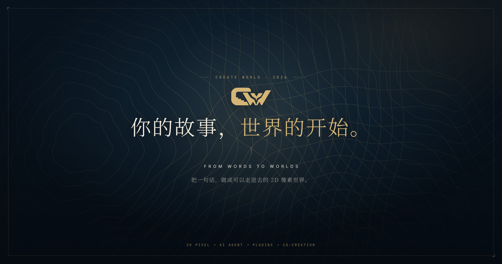
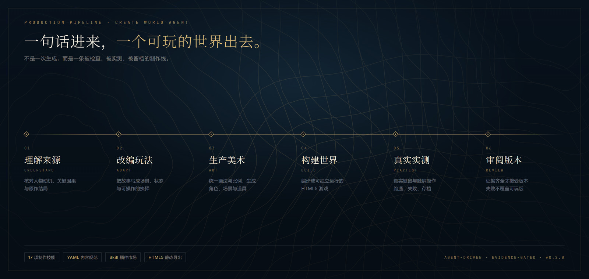
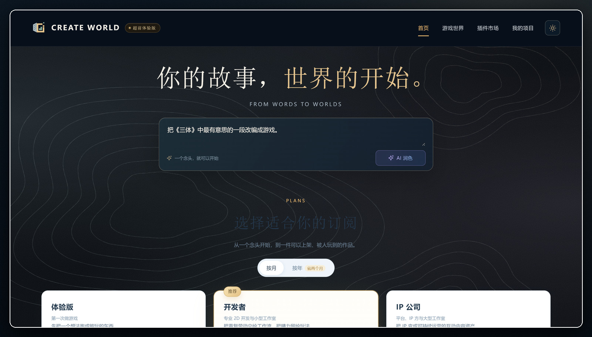
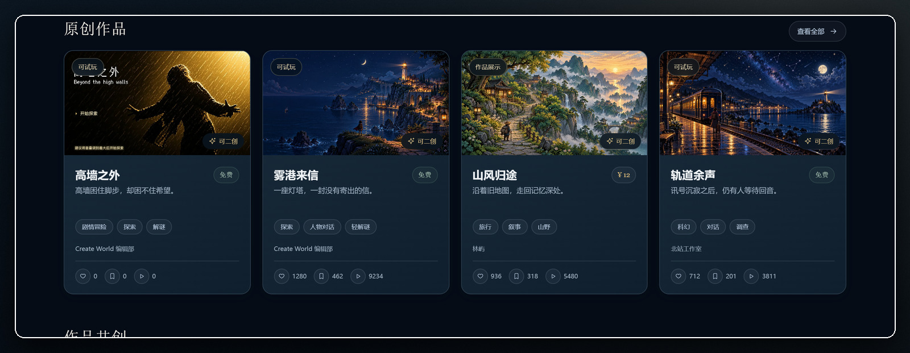
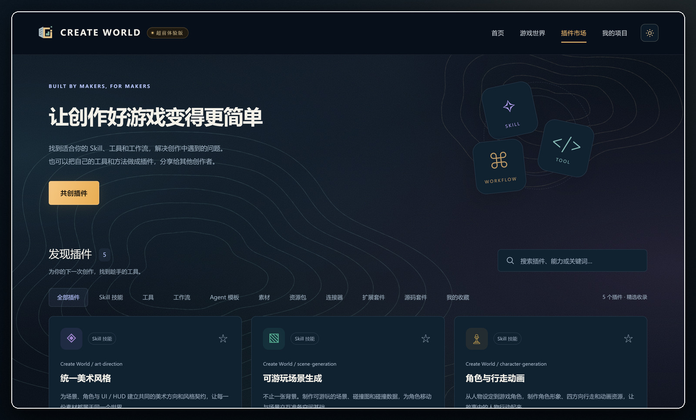
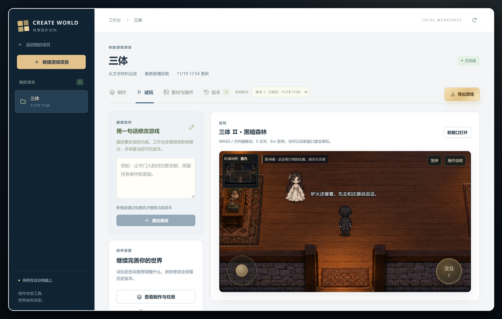
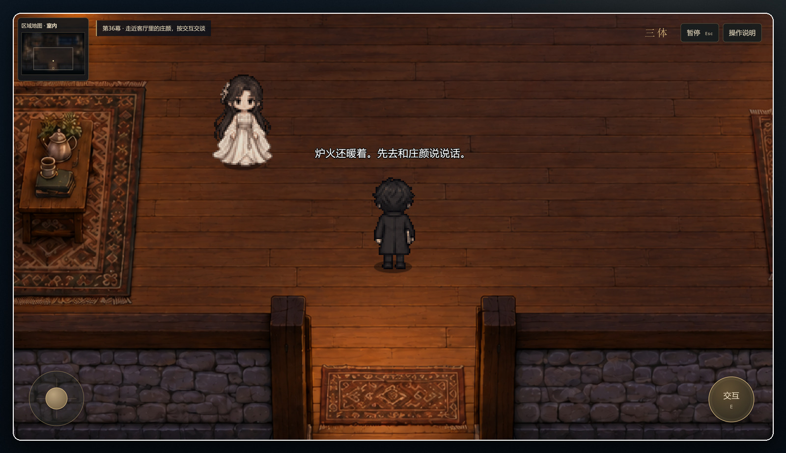
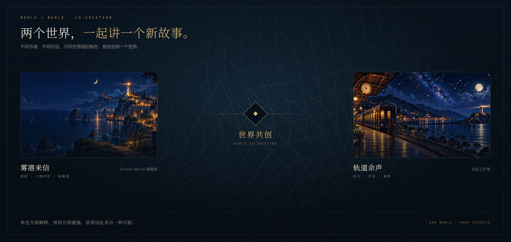

<div align="center">
  
</div>

<br/>

<div align="center">

**把一个念头，做成可以走进去的世界。**

`Create World` 是一个 AI 游戏创作平台：给它一句话、一段小说、一集剧本，
它还你一款能玩、能改、能发布的 **2D 像素剧情游戏**。

<sub>AI game creation · 2D pixel narrative · plugin ecosystem · world co-creation</sub>

<br/>

[](https://createworld.games)
[](PRODUCT.md)
[](create-world-workbench/package.json)
[](#-十秒钟读懂技术栈)
[](LICENSE)

<br/>

[**▶ 在线体验**](https://createworld.games) &nbsp;·&nbsp; [**产品介绍**](PRODUCT.md) &nbsp;·&nbsp; [**2 分 30 秒产品短片**](#-先看片) &nbsp;·&nbsp; [**跑起来**](#-把它跑起来) &nbsp;·&nbsp; [**English**](README.en.md)

</div>

<br/>

---

## 🎬 先看片

> 2 分 30 秒，从一句话到一款能玩的作品。带字幕，建议开声音。

https://github.com/user-attachments/assets/3c77994a-eac7-449b-a0c1-e046e7b2382d

<sub>↑ 视频直接托管在 GitHub，点开即播，不需要跳转 B 站或 YouTube。</sub>

---

## 一、这是什么

> **你写下的不是提示词，是一个世界的第一行。**

大多数人做不出游戏，不是因为不会写代码，而是因为「想法 → 可玩的东西」中间隔着一整条生产线：改编、分镜、美术、对白、交互、构建、测试、修 bug。

Create World 把这条生产线交给一个会自己安排工作的 AI 团队。你只需要描述你想做的世界——它会把故事拆成场景、把场景画成像素、把像素接上交互、把交互跑通，最后交给你一个**可以直接在浏览器里走进去**的游戏。

<table>
<tr>
<td width="50%" valign="top">

**它适合这样的你**

- 有一个很喜欢的故事，想亲自走进去
- 想给喜欢的角色写一个「如果」的番外
- 有 IP、有品牌，想把内容变成可互动的东西
- 是开发者，想把做游戏的经验变成可复用的插件

</td>
<td width="50%" valign="top">

**它不做什么**

- 不是「一键生成 3A 大作」的魔法按钮
- 不做开放世界沙盒，专注 **2D 像素剧情**
- 不替你决定故事的核心；它负责把它做出来
- 不隐藏 AI 的痕迹：哪里是原作、哪里是补写，都会标注

</td>
</tr>
</table>

---

## 二、三步，从一个念头到一款游戏

<table>
<tr>
<td width="33%" valign="top" align="center">

### 01 · 写下

一句话、一段梗概、一集剧本、一份 SRT 字幕，或者一整份结构化 YAML。

<sub>`把《三体》里最有意思的一段改编成游戏。`</sub>

</td>
<td width="33%" valign="top" align="center">

### 02 · 生成

AI 自己读故事、定玩法、画场景、写对白、搭运行时，并在真实浏览器里跑通它。

<sub>`10 分钟 · 5 个场景 · 像素风`</sub>

</td>
<td width="33%" valign="top" align="center">

### 03 · 走进

试玩、用一句话改、切版本、导出静态 HTML5，或者一键上架，让其他人也走进来。

<sub>`WASD 移动 · E 交互 · 手机横屏`</sub>

</td>
</tr>
</table>

<div align="center">
  
</div>

---

## 三、产品一瞥

> 以下页面都截取自线上产品，点击图片可以直达对应页面。

<div align="center">
  <a href="https://createworld.games"></a>
</div>

<div align="center"><sub><b>创作入口</b> —— 一句话就可以开始；AI 会先帮你说清楚你想做什么。</sub></div>

<br/>

<div align="center">
  <a href="https://createworld.games/#/games"></a>
</div>

<div align="center"><sub><b>游戏世界</b> —— 不是模型 demo 的陈列柜，是一个个被玩过的世界。</sub></div>

<br/>

<div align="center">
  <a href="https://createworld.games/#/plugins"></a>
</div>

<div align="center"><sub><b>插件市场</b> —— 把「怎么做一个好游戏」的经验，做成别人可以复用的能力。</sub></div>

<br/>

<div align="center">
  
</div>

<div align="center"><sub><b>工作台</b> —— 左边说人话，右边直接玩；改动会留下版本，失败不会覆盖能玩的版本。</sub></div>

<br/>

<div align="center">
  
</div>

<div align="center"><sub><b>真的能玩</b> —— 场景、角色、对白、地图、交互、存档，都是运行时里真实存在的。</sub></div>

---

## 四、四个能力，组成一个闭环

| | 能力 | 它解决什么 | 你能得到什么 |
| :--: | --- | --- | --- |
| ◆ | **AI 游戏制作** | 从「有想法」到「有作品」之间的整条生产线 | 描述 IP、故事或世界设定，生成可玩的 2D 像素剧情游戏，并用自然语言持续修改 |
| ◆ | **插件生态** | 好经验只留在一个人脑子里 | Skill、工具、工作流、素材包可以被上传、复用、推荐；做游戏的方法本身成为资产 |
| ◆ | **社区与二创** | 作品做完就死了 | 一键发布、评论反馈、版本迭代，以及「基于这个世界再做一款」的二创 |
| ◆ | **多世界共创** | 每个游戏都是一座孤岛 | 把不同作品的角色与世界观放进同一个世界，做联动、番外与跨世界叙事 |

<br/>

<div align="center">
  
</div>

---

## 五、世界们

> 这些不是渲染图，是已经上架或正在内测的作品。

| 世界 | 类型 | 状态 | 一句话 |
| --- | --- | :--: | --- |
| **三体 · 黑暗森林** | 科幻 / 剧情探索 | 可试玩 | 以罗辑的第一视角，走进黑暗森林 |
| **高墙之外** | 剧情冒险 / 解谜 | 可试玩 | 高墙困住脚步，却困不住希望 |
| **雾港来信** | 探索 / 轻解谜 | 可试玩 | 一座灯塔，一封没有寄出的信 |
| **山风归途** | 旅行 / 叙事 | 作品展示 | 沿着旧地图，走回记忆深处 |
| **轨道余声** | 科幻 / 调查 | 可试玩 | 讯号沉寂之后，仍有人等待回音 |
| **尘埃之外** | 科幻 / 双场景 | 可运行 | 依据《星际穿越》开篇梗概制作的独立小游戏，跑在自己的引擎上 |

<br/>

<details>
<summary><b>◆ 关于「共创」：为什么要把两个不相干的世界放在一起？</b></summary>

<br/>

因为玩家记得的从来不是「一个游戏」，而是**角色在某个瞬间做出的选择**。

当孙悟空走进大观园，当漫威英雄抵达三体文明，当 ChatGPT 遇上珍妮纺织机——真正有趣的不是设定碰撞，而是两种世界观在同一套规则下被迫互相解释。这是 Create World 想验证的事：**世界不是作品的外壳，世界是可以互相生长的。**

> 共创作品的封面与设定由创作者提供，平台负责把它变成可玩的场景与交互。

</details>

---

## 六、它是怎么做到的

> 不是「一个大模型写完了整个游戏」，而是一条可以被检查、被复现、被追责的生产线。

```text
             ┌──────────────────────────────────────────────────────────┐
             │                   CREATE WORLD  WORKBENCH                │
             └──────────────────────────────────────────────────────────┘
   一句话 / 小说 / 剧本 / SRT / YAML
                  │
                  ▼
      ┌───────────────────────┐        ┌──────────────────────────────┐
      │  内容理解 & 改编       │        │  18 个制作技能（Skills）      │
      │  人物动机 · 关键因果   │◄──────►│  美术方向 / 场景 / 角色 /     │
      │  原作结局 · 补写标注   │        │  玩法 / 叙事分支 / 运行时 …   │
      └───────────┬───────────┘        └──────────────────────────────┘
                  │
                  ▼
      ┌───────────────────────┐        ┌──────────────────────────────┐
      │  玩法 & 场景设计       │───────►│  YAML 内容档案（唯一事实源）  │
      │  状态机 · 事件窗口     │        │  场景 / 事件 / 角色 / 状态    │
      └───────────┬───────────┘        └──────────────────────────────┘
                  │
                  ▼
      ┌───────────────────────┐        ┌──────────────────────────────┐
      │  像素素材生产          │───────►│  母版 · 来源 · 检查记录       │
      │  统一画法 · 比例 · 光照│        │  角色三视图 / 四方向行走      │
      └───────────┬───────────┘        └──────────────────────────────┘
                  │
                  ▼
      ┌───────────────────────┐        ┌──────────────────────────────┐
      │  编译 & 构建           │───────►│  静态 HTML5 游戏（无后端）    │
      │  场景 / 碰撞 / 存档    │        │  `python -m http.server` 即玩 │
      └───────────┬───────────┘        └──────────────────────────────┘
                  │
                  ▼
      ┌───────────────────────┐        ┌──────────────────────────────┐
      │  真实浏览器实测        │───────►│  键鼠 / 触屏 · 推进 / 失败 /  │
      │  Playwright 驱动       │        │  取消 / 中途刷新 / 存档恢复   │
      └───────────┬───────────┘        └──────────────────────────────┘
                  │
                  ▼
      ┌──────────────────────────────────────────────────────────────┐
      │  审阅 & 接受版本：构建、实测、审阅、资源记录齐全才替换可玩版 │
      └──────────────────────────────────────────────────────────────┘
```

<details>
<summary><b>◆ 十秒钟读懂技术栈</b></summary>

<br/>

| 层 | 选择 | 说明 |
| --- | --- | --- |
| 前端 | **React 19 + Vite 7 + TypeScript 5.9** | 工作台、社区、插件市场共用一套 UI 与设计语言 |
| 服务端 | **Node.js 24 + TypeScript (tsx)** | 本地优先；SQLite 保存项目、运行、版本与证据 |
| 智能体 | **Codex App Server + 18 Skills** | 模型自己决定读哪个技能、按什么顺序做，而不是走固定流水线 |
| 内容 | **YAML 内容规范 + 场景切片** | 场景、事件、角色、状态、玩法都有稳定 ID，可校验、可 diff |
| 素材 | **Pillow / 原生图像生成 + 确定性检查** | 母版、来源、检查记录一起入库 |
| 验收 | **Playwright（Chromium / Firefox / WebKit）** | 真实输入跑通关、失败、取消、刷新与存档恢复 |
| 交付 | **静态 HTML5 导出** | 导出后不需要 Codex、工作台或后端进程 |

</details>

<details>
<summary><b>◆ 为什么不是「让模型直接写一个网页游戏」？</b></summary>

<br/>

因为「能跑」和「能玩」是两件事。

直接生成一个网页游戏，通常能得到一个 demo；但它很难回答这些问题：这个场景的入口在哪？玩家失败之后还能不能继续？改了一句对白，会不会把别的场景弄坏？上一版还能不能回去？

Create World 的答案是：**把内容变成有 ID 的档案，把制作变成有记录的任务，把验收变成真实操作。** 所以它慢一点，但它做出来的东西可以被继续修改、被审阅、被复用。

</details>

---

## 七、把它跑起来

> 两种方式：只想看看，或者想自己做一个世界。

**A. 只看前端体验版（无需后端）**

```bash
git clone https://github.com/Leizhidong-creator/CreateWorld.git
cd CreateWorld/create-world-workbench
npm ci
npm run build
npx serve dist/web     # 或者任意静态服务器
```

打开后是一个**纯前端演示**：项目、修改、版本都保存在你的浏览器 localStorage 里，不会调用任何后端。
体验账号：`creator` / `createworld`。

**B. 跑完整工作台（需要本机 Codex CLI）**

```bash
cd CreateWorld/create-world-workbench
npm ci
npm run build
npm start              # http://127.0.0.1:8787
```

> 需要 Node.js 24+、已登录的 Codex CLI 与 Python 3。完整依赖与配置见
> [工作台说明](create-world-workbench/README.md) 与 [架构文档](create-world-workbench/docs/ARCHITECTURE.md)。

**C. 玩一个已经导出的游戏**

```bash
cd CreateWorld/interstellar-dust
npm start              # http://127.0.0.1:4173
```

导出的游戏是纯静态 HTML5：解压后 `python3 -m http.server 8000` 就能玩，不需要模型、后端或网络。

<br/>

<details>
<summary><b>◆ 给工程师的目录导览</b></summary>

<br/>

```text
CreateWorld/
├─ create-world-workbench/          # 工作台：React 前端 + Node 服务 + 智能体编排
│  ├─ apps/web/                     # 社区、游戏世界、插件市场、工作台
│  ├─ apps/server/                  # 本地 API、SQLite、SSE
│  ├─ packages/orchestrator/        # 任务生命周期、工具运行时、候选与版本
│  ├─ packages/runtime/             # 场景转场、状态、存档
│  ├─ packages/compiler/            # 内容 → 可运行游戏的编译
│  ├─ packages/assets/              # 素材生产、校验与缓存
│  ├─ packages/browser-runner/      # 真实浏览器操作与状态观测
│  └─ content-spec/                 # 2D 像素剧情内容规范（YAML）
├─ interstellar-dust/               # 《尘埃之外》：可直接运行的像素剧情游戏
├─ .agents/skills/                  # 18 个制作技能（角色 / 场景 / 玩法 / 审阅 …）
├─ docs/                            # 架构、验收记录与完整工程说明
├─ assets/                          # README 与 PRODUCT.md 使用的品牌与截图资源
├─ PRODUCT.md                       # 产品介绍：用户、能力、商业与路线图
└─ scripts/                         # 打包、内容切片，以及一个彩蛋
```

</details>

---

## 八、现在进行到哪

<table>
<tr>
<td align="center" width="25%">

### 100+

**内测意向用户**

愿意参与试用与测试

</td>
<td align="center" width="25%">

### 100+

**社群成员**

每天在群里吵架、提需求

</td>
<td align="center" width="25%">

### 5

**已上架世界**

科幻、悬疑、旅行、解谜

</td>
<td align="center" width="25%">

### 18

**制作技能**

从美术方向到验收审阅

</td>
</tr>
</table>

<br/>

**下一步**

- [x] 纯前端体验版上线（`createworld.games`）
- [x] 《三体》《高墙之外》等作品完成全流程制作
- [x] 插件市场、共创页、工作台版本管理
- [ ] 后台并发调度与异常恢复
- [ ] 核心用户灰度（分批开放）
- [ ] 商业化试点：创作订阅 / IP 定制 / 作品交易

<sub>内测数据由项目方提供，两类群体可能重合，不合并计算。</sub>

---

## 九、我们

> 四个人，三种专业，一个很具体的执念：**让没有开发经验的人，也能把自己喜欢的故事变成可以玩的东西。**

<table>
<tr>
<td width="50%" valign="top">

**CW Team** · 太原理工大学

- 3 人 · 计算机科学与技术（211）
- 1 人 · 数字媒体艺术
- 分工覆盖产品、Agent 链路、系统开发与 UI/UX

</td>
<td width="50%" valign="top">

**做过的事**

- 2026 字节跳动抖音 AI 创变者比赛 · 全国决赛二等奖
- 政企 AI 会议室系统 · 一个月交付
- 餐饮「知膳 AI」系统 · 多门店交付

</td>
</tr>
</table>

---

## 十、彩蛋

<details>
<summary><b>◆ 点开的人，会得到一个世界种子</b></summary>

<br/>

```text
        ██████╗██╗    ██╗
       ██╔════╝██║    ██║
       ██║     ██║ █╗ ██║
       ██║     ██║███╗██║
       ╚██████╗╚███╔███╔╝
        ╚═════╝ ╚══╝╚══╝     create world

  SEED     0x7A3F-2026
  WORLD    雾港
  WEATHER  小雨，灯塔亮着
  FIRST    「先去看看那封信。」
```

在终端里运行 `node scripts/seed.mjs`，你会得到属于你的那一个。

</details>

---

<div align="center">

### 你的故事，世界的开始。

<sub>FROM WORDS TO WORLDS</sub>

<br/>

[官网](https://createworld.games) &nbsp;·&nbsp; [产品介绍](PRODUCT.md) &nbsp;·&nbsp; [GitHub](https://github.com/Leizhidong-creator/CreateWorld) &nbsp;·&nbsp; [邮箱](mailto:3290659791@qq.com)

<br/>

<sub>© 2026 CW Team · 源码与素材为团队私有资产，未经授权请勿商用或再分发。</sub>
<sub>《三体》等第三方 IP 相关作品为内测用户二创 demo，版权归原权利人所有；如涉侵权请联系删除。</sub>

</div>


