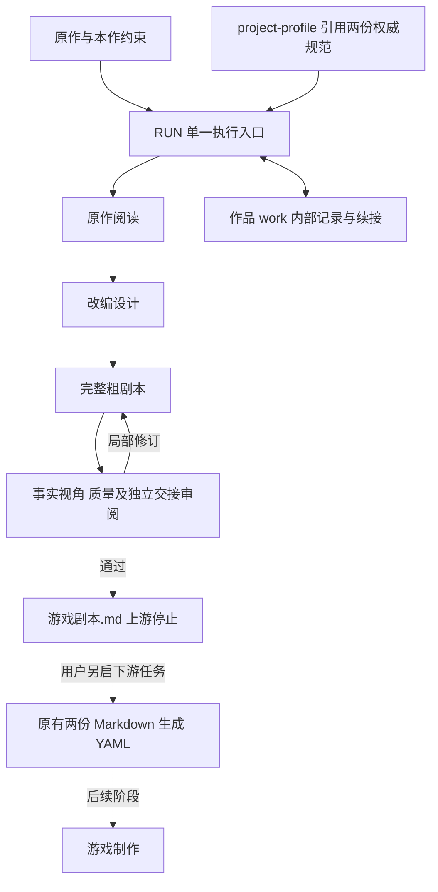

# 原作改编工作流架构

版本1.1.1 · 2026-10-31

从 [RUN.md](RUN.md) 启动。这里提供可交给 Codex 顺序执行的文件工作流，交付一份完整自然语言粗剧本。它已落到本仓库，不需要额外 Agent 服务。后台任务接入见 [文本流程接口](../../create-world-workbench/docs/TEXT-WORKFLOW-API.md)；当前尚未接入网页按钮。

| 位置 | 职责 |
|---|---|
| [RUN](RUN.md) | 唯一启动、阶段、询问、续接、停止与交付 |
| [project-profile](project-profile.md) | 上游通用边界及现有规范路径与校验值 |
| [source-reading](methods/source-reading.md) | 全范围阅读、原作事实、因果、认知与证据 |
| [adaptation-design](methods/adaptation-design.md) | 固定类型内决定视角、参与、揭示和时间处理 |
| [script-writing](methods/script-writing.md) | 全篇自然语言粗剧本与来源交接 |
| [script-review](methods/script-review.md) | 事实视角、改编质量、独立交接三个审阅关注点 |
| [game-script](templates/game-script.md) | 轻量正文模板 |
| [workspace](templates/workspace/README.md) | 空白作品目录与进度模板 |
| [UPSTREAM](UPSTREAM.md) | 固定上游、许可、采用范围、修改与更新规则 |
| [检查程序](checks/validate_workflow.py) | 只读检查本地链接、必需文件、来源哈希及误装入口 |
| [ACCEPTANCE](ACCEPTANCE.md) | 实际检查、证据和未验证边界 |

作品放在仓库根目录 adaptations 的独立子目录，原作可引用原位置，内部记录留在 work，正式粗稿放 output。该目录默认忽略私有作品。验证样例留在仓库 output/story-adaptation-implementation，未混入通用模板。

现有 create-world-workbench、interstellar-dust 及其技能配置保持原样；旧 `pixel-story-kit` 独立目录已移除，其来源记录转存于 `interstellar-dust/provenance/`。本工作流没有把自然语言粗稿自动转换成当前工作台的 GameConfig；两个阶段依靠明确的文本交接，而非假称已有可执行接口。

1.1版增加指定角色经历线、三层认知、关键参与机制、隐藏用途回扣、分段阅读账与隔离交接审阅。作品约束保存在各自目录，不进入通用规则。
